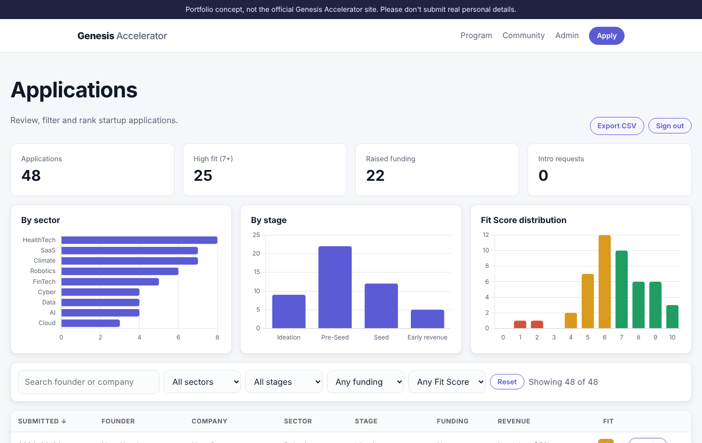
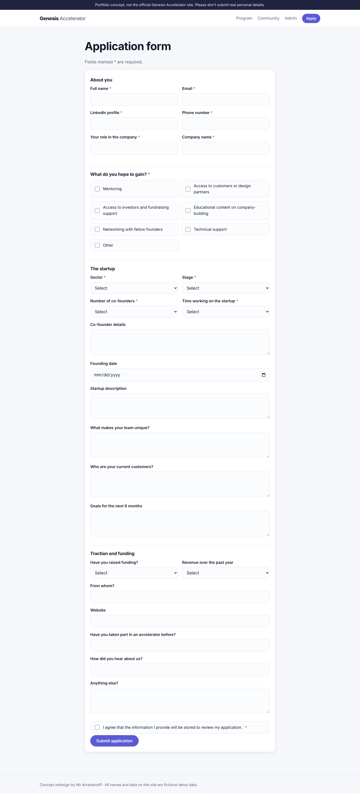
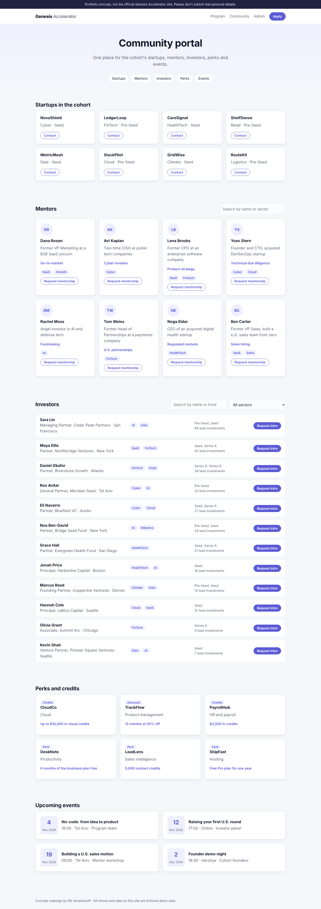

# Genesis Accelerator Portal (concept)

**Live demo:** [genesis-accelerator-web-l51s.onrender.com](https://genesis-accelerator-web-l51s.onrender.com/) · admin password `demo` · the free server can take up to a minute to wake up.

A working web portal for a startup accelerator. Founders apply through a validated form. The program team reviews and ranks applications in an admin dashboard. Founders, mentors and investors connect through a community portal.

I built it on my own as a UX course project. The case was the Genesis Accelerator, where I worked as a data analyst intern, and the goal was to design the complete flow from application to review. It is a concept, not the accelerator's official site. The team photo is real and used with permission. Every applicant, mentor, investor and startup in the portal is fictional demo data.



<p align="center"><br><em>The Genesis Accelerator team. I was the team's analyst.</em></p>

## What it does

| Area | Features |
|---|---|
| Application form | Grouped sections, server-side validation with inline error messages, entered values kept after an error, consent checkbox |
| Admin dashboard | Password-protected; KPI tiles; charts by sector, stage and Fit Score; search and combined filters; sortable table; details view; CSV export |
| Fit Score | A transparent 0-10 ranking from stage, team size, time on the startup, customers and funding ([scoring.py](scoring.py)) |
| Community portal | Cohort startups, mentors and investors with search and sector filters; perks; events; introduction requests that appear in the admin dashboard |

## Design decisions

**Rank applications, don't just list them.** Reviewers read dozens of free-text applications. The Fit Score sorts them by how well they match the program's stated profile, so the strongest candidates come first. The weights are my own assumptions about that profile and are documented in the code. With real outcome data (who was accepted, who raised a round), they could be fitted instead of set by hand.

**Validate on the server.** The browser checks can be bypassed, so every field is checked again in [forms.py](forms.py). That covers required fields, allowed options, email format and length limits.

**Treat applicant data as sensitive.** The dashboard needs a password, forms are protected against cross-site request forgery, and all user text is inserted into the page as text, never as HTML. In demo mode, contact details of anything a visitor submits are masked in the dashboard and the CSV export.

| Application form | Community portal |
|---|---|
|  |  |

## Run it locally

```bash
pip install -r requirements.txt
python app.py
```

Open http://localhost:5000. The admin password in demo mode is `demo`. The database is created and seeded with 48 fictional applications on first run.

| Environment variable | Default | Purpose |
|---|---|---|
| `DEMO_MODE` | `1` | Seeds demo data, shows the demo banner and masks contact details of real submissions |
| `ADMIN_PASSWORD` | `demo` in demo mode | Admin password. Outside demo mode the dashboard is disabled until this is set |
| `SECRET_KEY` | random | Session signing key. Set a fixed value in production |
| `DATABASE` | `instance/portal.db` | SQLite file path |

Tests:

```bash
pip install -r requirements-dev.txt
pytest
```

## Deploy

[render.yaml](render.yaml) deploys the app to Render with gunicorn. On Render's free tier the SQLite file is reset on each deploy, which suits a demo. A real deployment would use a managed database such as PostgreSQL.

## Structure

```
├── app.py              Routes, admin login, CSRF protection, CSV export
├── forms.py            Form options and server-side validation
├── scoring.py          Fit Score weights and rationale
├── db.py               SQLite schema and fictional demo data
├── data/community.json Fictional mentors, investors, startups, perks and events
├── templates/          Jinja templates sharing one base layout
├── static/             CSS, JavaScript and a local copy of Chart.js
└── tests/              Route, validation, security and scoring tests
```

## Tools

Python, Flask, SQLite, Jinja, HTML, CSS, JavaScript, Chart.js, pytest.

## Credits

Design and development by Nir Avrahamoff. Chart.js is included under its MIT license.
